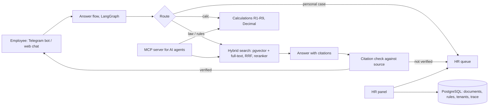

# HRgid

An AI assistant for HR teams that answers employees' questions about the **Russian Labour Code (TK RF)**
and their company's own rules. Every answer cites the article and quotes the source. When there is no
basis for an answer, it says so and passes the question to HR.

Interface language: **Russian** (the product serves Russian employees; the law text, company rules and
evaluation sets are Russian content). The code, documentation and developer messages are in English.

> Not legal advice. An answer is a reference with a source link; disputed cases are for HR and a lawyer.

Channels: a Telegram bot, a web chat, an MCP server for AI agents, and a web panel for HR.
Stack: Python 3.12, FastAPI, LangGraph, PostgreSQL 16 with pgvector, Redis, aiogram.

## Features

- **Law and company rules.** Hybrid search (vector + full text), local reranking, answers built only from
  retrieved fragments. Every claim is checked against the quoted source; an answer without a supporting quote
  is not sent (ADR-0001, 0002, 0003, 0006).
- **Calculations.** Leave, sick pay, overtime and deadlines are computed by deterministic Python code
  (rules R1-R9). The model only calls the tools and explains the result.
- **Telegram bot** for employees: consent to personal-data processing, sign-in by code, questions,
  calculations, requests to HR (scenarios 4.1-4.8).
- **HR panel** (sections P0-P11): request queue, answer base, company documents with a check against the
  Labour Code, employees and groups, analytics, settings, action journal, undo.
- **Web chat** via an invite link, and an **MCP server** with read-only tools for AI agents.
- **Personal data:** masking before the model (names, passport, SNILS, TIN, phone, e-mail), tenant
  isolation by `tenant_id` in every table, 1-year retention.

## Requirements

- Docker with Docker Compose v2.24+ (recommended), or Python 3.12 for development.
- The first start downloads and indexes the law text on CPU, which takes a long time; later starts take seconds.
- Internet access on the first start (the Labour Code text is downloaded).
- No API keys are needed to run. Without a model key every answer is a refusal, while search, the panel
  and the web chat work.
- Optional: an API key for the model provider (OpenRouter, Claude, GigaChat or YandexGPT) and a Telegram
  bot token from @BotFather.

## Installation

### Option A: Docker Compose (Windows, macOS, Linux)

1. Install Docker Desktop (Windows, macOS) or Docker Engine with the Compose plugin (Linux). Check:

   ```bash
   docker compose version
   ```

   The version must be v2.24 or newer.

2. Clone the repository and enter the folder:

   ```bash
   git clone https://github.com/zhichkin44-del/hrgid.git
   cd hrgid
   ```

3. Start everything:

   ```bash
   docker compose up
   ```

   Or `make up` if you have GNU Make. The first start is slow: the `init` service downloads the Labour
   Code, indexes it on CPU and creates the first company. Later starts take seconds.

4. Open the panel at <http://localhost:8000>. Sign-in is by e-mail (`HRGID_ADMIN_EMAIL`). With the default
   mail mode the one-time code is written to a file inside the container:

   ```bash
   docker compose exec api sh -c 'cat /var/lib/hrgid/outbox/*'
   ```

5. The web chat link is printed by:

   ```bash
   docker compose exec api cat /var/lib/hrgid/web_invite
   ```

   Open `http://localhost:8000/c/<token>`.

6. Health check: `curl http://localhost:8000/healthz` returns `{"status": "ok"}`.

To stop: `docker compose down` (or `make down`).

### Option B: Python for development (Windows, macOS, Linux)

Python 3.12 is required. Some native libraries (PyTorch, libpq) may be blocked by security software on
Windows (for example Smart App Control); in that case use Option A or the CI logs.

```bash
git clone https://github.com/zhichkin44-del/hrgid.git
cd hrgid
python -m venv .venv
# Windows (PowerShell):  .venv\Scripts\Activate.ps1
# macOS / Linux:         source .venv/bin/activate
python -m pip install --upgrade pip
pip install torch --index-url https://download.pytorch.org/whl/cpu
pip install -e ".[dev]"
```

Then:

```bash
python scripts/fetch_tk.py     # downloads the Labour Code text into data/raw
python scripts/run_panel.py    # panel on a filled demo company, fake model
python -m hrgid.bot            # Telegram bot (needs TELEGRAM_BOT_TOKEN and DATABASE_URL or pgserver)
```

## Configuration

Copy the template and fill in what you need:

```bash
cp .env.example .env            # Windows: copy .env.example .env
```

Every variable is optional for a first run. The most important ones:

| Variable | Purpose | Where to get it |
|---|---|---|
| `HRGID_LLM_PROVIDER` | model: `fake` (default), `openrouter`, `claude`, `gigachat`, `yandex` | - |
| `OPENROUTER_API_KEY` | key for OpenRouter | <https://openrouter.ai/keys> |
| `ANTHROPIC_API_KEY` | key for Claude | <https://console.anthropic.com/> |
| `GIGACHAT_CREDENTIALS`, `YANDEX_API_KEY`, `YANDEX_FOLDER_ID` | keys for Russian providers | the provider's console |
| `TELEGRAM_BOT_TOKEN` | Telegram bot token | create a bot with @BotFather |
| `HRGID_COMPANY`, `HRGID_COMPANY_NAME` | first company | any short id and display name |
| `HRGID_ADMIN_EMAIL`, `HRGID_ADMIN_NAME` | first HR administrator | your e-mail |
| `HRGID_PANEL_PEPPER`, `HRGID_CODE_PEPPER` | secrets for hashing codes | leave empty: generated on the first start |
| `POSTGRES_PASSWORD` | database password (letters and digits only) | choose one |
| `HRGID_MAIL` | `log` writes codes to the log, empty writes a file in the volume | - |
| `HRGID_RETENTION_DAYS` | retention of dialogues in days (default 365) | - |

Do not commit `.env` (it is in `.gitignore`). Keys are never stored in the repository. For a model
provider, set `HRGID_LLM_PROVIDER` and the matching key in `.env`.

Cross-border transfer: Claude and OpenRouter send masked data to servers in the USA. The administrator
enables them in the panel (section P9.5) with a warning, and employees are notified.

## Usage

1. Open the panel, sign in, and upload the company's documents: they are checked against the Labour Code.
2. Open the Telegram bot as an employee, accept the consent, and ask a question, for example
   "How many days of paid annual leave do I have?". The answer cites the article.
3. Or open the web chat link and ask the same question.
4. An AI agent can use the MCP server. Create a token in the panel (Settings, "Token for AI agents") and
   connect it:

   ```bash
   claude mcp add hrgid -e HRGID_MCP_TOKEN=hrg_YOUR_TOKEN -e DATABASE_URL=postgresql://... -- python -m hrgid.mcp
   ```

   Tools: `search_law`, `search_policy`, `calc`, `check_policy_clause`. Remote access over streamable
   HTTP: `python -m hrgid.mcp --http --port 8765`, endpoint `/mcp`, header `Authorization: Bearer hrg_...`.

## Tests and quality checks

```bash
make lint                       # ruff + mypy --strict
make test                       # fast tests (pytest -m "not slow")
pytest -m "not slow and not browser"   # what the install check runs
pytest -m browser -rs           # browser end-to-end tests of the panel (Playwright; playwright install chromium)
make gate                       # quality gate on recorded model answers
make record                     # records model answers with your own key (PROVIDER=openrouter|claude|gigachat|yandex)
```

Markers: `db` (needs PostgreSQL with libpq), `natasha` (downloads NLP models), `browser` (needs Playwright),
`slow` (needs models and a local database). The CI jobs in `.github/workflows/ci.yml` run them.

How the quality gate works (`.github/workflows/ci.yml`, ADR-0003): CI does not call a model. It replays
recorded answers from `tests/recordings/`. The recording key is a hash of (prompt + model + set version): if
you change a prompt without re-recording, the gate turns red on purpose. `tests/test_quality_gate.py` proves
that the gate turns red on a deliberately degraded prompt.

## Quality

The quality table is filled in by a live run with the owner's key. **It is not filled in yet.** No numbers
are invented: an empty cell means that the measurement has not been done.

| Metric | Threshold |
|---|---|
| hit@5 on the law | >= 0.85 |
| correct article in the answer | >= 85 % |
| correct refusals ("no answer") | >= 9 of 10 |
| rejected prompt injections | 5 of 5 |
| calculations to the rouble | 10 of 10 |
| search, p95 on CPU | <= 400 ms |
| answer, p95 | <= 8 s |

The evaluation set has 80+ questions (`data/evals/`).

Cost per answer is computed from real token usage and the provider price list (`hrgid/llm/base.py`,
`cost_rub`) and written to every trace. A live run of 200 questions for the cost per 1,000 answers is not
done yet.

## Architecture



## Project structure

```
src/hrgid/flow/     answer flow (LangGraph): routing, search, answer, citation check, calculations
src/hrgid/search/   hybrid search, reranking, tenant isolation
src/hrgid/calc/     calculations R1-R9 (pure Decimal functions, rules in YAML)
src/hrgid/llm/      model adapters (fake, OpenRouter, Claude, GigaChat, YandexGPT), retries, cache
src/hrgid/bot/      Telegram bot (aiogram), dialogue engine, outbox
src/hrgid/panel/    HR panel (FastAPI, Jinja2)
src/hrgid/mcp/      MCP server for AI agents
data/               law text, company rules, calendar, evaluation sets (Russian content)
docs/adr/           architecture decision records (English)
tests/              pytest suites; tests/recordings holds recorded model answers
```

## Documentation

- [Threat model](docs/threat-model.md): threat, control, test.
- [Incident response](docs/incident-response.md): what to do after a leak, including the notification
  deadlines for the regulator (24 hours and 72 hours).
- [Architecture decision records](docs/adr): options considered and the reasons for the choices.

## Limitations

- Only the Labour Code of the Russian Federation, Federal Law 255-FZ and the production calendar, company
  rules and documents are covered. Other legislation and court practice are not included.
- An answer is a reference with a source link, not a legal opinion. If there is no basis, the assistant
  refuses and passes the question to HR.
- The default model is a fake model that refuses everything until you configure a provider. The
  Russian providers (GigaChat, YandexGPT) and Claude / OpenRouter are optional.
- No real e-mail is sent: the sign-in code is written to a file in the volume (self-hosted mode).
- The live recording of answers and the load test are not done yet, so the quality table is empty.
- Not in v1: voice, integration with HR systems, document signing.

## Security and personal data (Russian Federal Law 152-FZ)

- Employee consent at the first sign-in; `/privacy` describes the data, the retention period and deletion
  on request.
- Masking of names, passport, SNILS, TIN, phone and e-mail before anything goes to the model. The mapping
  table lives only in memory for the request.
- Company isolation: `tenant_id` in every table, query, cache and trace. Dialogues are visible only to HR of
  the same company. Retention is 1 year (`HRGID_RETENTION_DAYS`, cleaned by the `worker` service).
- The image runs as a non-root user; the database and Redis are not published to the host; secrets come only
  from the environment or a volume; `.env.example` has no values.

## License

Source-available, all rights reserved: the code is published for viewing and evaluation only.
Commercial or production use requires written permission. See [LICENSE](LICENSE).
