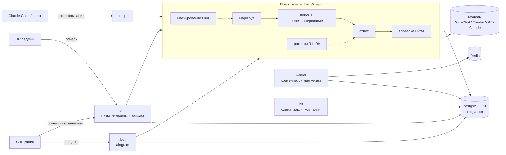

# HRgid

ИИ-помощник HR: отвечает сотрудникам по Трудовому кодексу РФ и правилам их компании **со ссылкой на
статью и цитатой из источника**. Не нашёл основание — так и говорит и передаёт вопрос HR. Работает в
Telegram, в веб-чате и через MCP; HR ведёт компанию в панели.

> Не юридическая консультация. Ответ — справка со ссылкой на источник; спорные случаи решает HR и юрист.

## Что умеет

- **Закон и правила компании.** Гибридный поиск (вектор + полнотекст), локальное переранжирование,
  ответ строго из найденных фрагментов; каждое утверждение проверяется цитатой, которой не нашлось в
  источнике — ответ не выдаётся (ADR-0001…0003, 0006).
- **Расчёты** отпуска, больничного, сверхурочных, сроков: считает детерминированный Python, модель
  только вызывает инструменты и объясняет (R1–R9).
- **Telegram-бот** для сотрудника: согласие на обработку данных, вход по коду, вопросы, расчёты,
  обращения к HR (сценарии 4.1–4.8).
- **Панель HR** (П1–П11): очередь обращений, база ответов, документы компании и проверка правил на
  соответствие ТК, сотрудники и группы, аналитика, настройки, журнал действий, отмена.
- **Веб-чат** по ссылке-приглашению и **MCP-сервер** (этап 7).
- **Персональные данные:** маскирование перед моделью, изоляция компаний по `tenant_id`, кэш без данных
  профиля, хранение 1 год.
- **Качество проверяется в CI**: ответы модели записаны, при изменении промпта без новых записей CI
  краснеет намеренно.

## Схема



## Запуск одной командой

Нужны Docker и Docker Compose v2.24+.

```
git clone <репозиторий> hrgid && cd hrgid
docker compose up            # или: make up
```

Ключи не нужны: без них модель выключена (`HRGID_PROVIDER=fake`, на любой вопрос честный отказ), а
поиск по закону, панель и веб-чат работают. Первый старт долгий: сервис `init` загружает текст ТК
(нужна сеть), индексирует его на CPU и создаёт первую компанию. Повторные запуски — секунды.

| Что | Где |
|---|---|
| Панель HR | http://localhost:8000 (вход по почте `HRGID_ADMIN_EMAIL`; письмо с кодом лежит файлом: `docker compose exec api sh -c 'cat /var/lib/hrgid/outbox/*'`) |
| Веб-чат | `http://localhost:8000/c/<токен>`; токен: `docker compose exec api cat /var/lib/hrgid/web_invite` |
| Проверка | `curl http://localhost:8000/healthz` |

Настройка — `cp .env.example .env` и значения (все необязательны): `HRGID_PROVIDER` (`gigachat`,
`yandex`, `claude`) и ключ выбранного провайдера, `TELEGRAM_BOT_TOKEN`, `HRGID_COMPANY`,
`HRGID_ADMIN_EMAIL`. Сервис `bot` без токена ждёт и пишет причину в журнал, не падая. Секреты-«перцы» (`HRGID_PANEL_PEPPER`, `HRGID_CODE_PEPPER`) без значений создаются случайными
и хранятся в томе `state`. Устройство образов и причины решений — [ADR-0007](docs/adr/0007-compose-one-image.md).

### Без Docker (разработка)

```
pip install torch --index-url https://download.pytorch.org/whl/cpu
pip install -e ".[dev]"
python scripts/fetch_tk.py          # текст ТК -> data/raw
python scripts/run_panel.py         # панель на наполненной компании «Студия Жичкина», Fake-модель
python -m hrgid.bot                 # бот (нужны TELEGRAM_BOT_TOKEN, ключ модели, DATABASE_URL или pgserver)
```

## MCP-сервер (этап 7)

ИИ-агенты (Claude Code, Claude Desktop) получают те же знания, что и бот, только на чтение:
`search_law` (ТК РФ со ссылкой на статью), `search_policy` (действующие правила вашей компании),
`calc` (расчёты R1–R9; у каждого своя схема входа), `check_policy_clause` (оценка пункта правил:
«соответствует / лучше закона / риск» со статьёй). Данные других компаний недоступны, ПДн в ответах
маскируются ([ФИО_1], [ТЕЛЕФОН_1] …), текст пункта уходит в модель замаскированным.

1. Администратор открывает панель: «Настройки» → «Токен для ИИ-агентов…» → «Выдать токен».
   Токен (`hrg_…`) показывается один раз, хранится хэшем, отзывается там же — действует сразу.
2. Подключение к Claude Code одной строкой:

```
claude mcp add hrgid -e HRGID_MCP_TOKEN=hrg_ВАШ_ТОКЕН -e DATABASE_URL=postgresql://... -- python -m hrgid.mcp
```

3. Claude Desktop (`claude_desktop_config.json`):

```json
{
  "mcpServers": {
    "hrgid": {
      "command": "python",
      "args": ["-m", "hrgid.mcp"],
      "env": {
        "HRGID_MCP_TOKEN": "hrg_ВАШ_ТОКЕН",
        "DATABASE_URL": "postgresql://...",
        "ANTHROPIC_API_KEY": "нужен только для check_policy_clause"
      }
    }
  }
}
```

Удалённый доступ (streamable HTTP): `python -m hrgid.mcp --http --port 8765`, адрес `/mcp`,
токен в заголовке `Authorization: Bearer hrg_…` (без токена или с отозванным — 401).
Модель проверки пункта — `HRGID_PROVIDER` (claude, gigachat, yandex); без ключа остальные три
инструмента работают. Тесты: `pytest tests/mcpsrv tests/panel/test_mcp_tokens.py`.

## Тесты и качество

```
make lint        # ruff + mypy --strict
make test        # быстрые тесты (pytest -m "not slow")
pytest -m browser -rs      # браузерные e2e панели (Playwright; playwright install chromium)
make gate        # ворота качества: набор на записанных ответах (БД, e5, закон)
make record      # локально, ключом владельца: записать ответы модели (PROVIDER=claude|gigachat|yandex)
```

Как устроены ворота (`.github/workflows/ci.yml`, ADR-0003): CI не вызывает модель, а воспроизводит
записи из `tests/recordings/`. Ключ записи = хэш(промпт + модель + версия набора): изменили промпт,
не обновили записи — ворота красные. Пока первой живой записи нет (файл `tests/recordings/PENDING`),
шаг пропускается с предупреждением в журнале CI. Что ворота краснеют, доказывает
`tests/test_quality_gate.py` (Fake-модель, нарочно ухудшенный промпт и ухудшенные записи).

Задачи CI: `check` (ruff, mypy --strict, быстрые тесты на PostgreSQL с pgvector), `e2e` (Chromium),
`quality-gate`, `compose-smoke` (чистый клон → `docker compose up` → панель и веб-чат отвечают).

## Качество

Таблица заполняется живым прогоном ключом владельца; **появится после живого прогона** (`make record`,
затем нагрузочный прогон этапа 9). Числа не выдумываются: пока ячейка пуста, измерения не было.

| Метрика | Порог | «Только вектор» | «Гибрид» | «+ переранжирование» | «+ проверка цитат» |
|---|---|---|---|---|---|
| hit@5 на законе | ≥ 0,85 | | | | |
| Правильная статья в ответе | ≥ 85 % | | | | |
| Верные отказы («ответа нет») | ≥ 9 из 10 | | | | |
| Отбитые инъекции | 5 из 5 | | | | |
| Расчёты до рубля | 10 из 10 | | | | |
| Поиск, p95 на CPU | ≤ 400 мс | | | | |
| Ответ, p95 | ≤ 8 с | | | | |

Дата и состав прогона будут указаны под таблицей (набор: 80+ вопросов, `data/evals/`).

## Стоимость ответа

Считается по токенам реального ответа и прайсу провайдера (`hrgid/llm/base.py`, `cost_rub`) и пишется
в каждую трассу (`traces.cost_rub`, панель П8). Один ответ = вызов дешёвой модели (маршрут, проверка
цитат) + вызов основной; ответ из кэша стоит 0 ₽. Цифра «стоимость 1 000 ответов в ₽» появится после
живого прогона 200 вопросов (§13) и будет записана здесь с датой. Сейчас — **не измерено**.

## Ограничения

- Только Трудовой кодекс РФ, 255-ФЗ и производственный календарь, правила и документы компании;
  иное законодательство и судебная практика не входят.
- Это справка со ссылкой, а не юридическое заключение; при отсутствии основания — отказ и передача HR.
- Модель по умолчанию российская (GigaChat/YandexGPT); Claude включается администратором с
  предупреждением о трансграничной передаче (данные уходят замаскированными).
- Реальной отправки почты нет: код входа в панель кладётся файлом в том (режим самостоятельной установки).
- Живой записи ответов и нагрузочного прогона пока нет: таблица качества пуста.
- Не входит в v1: голос, интеграции с кадровыми системами, подписание документов (см. SPEC §18).

## Безопасность и 152-ФЗ

- Согласие сотрудника при первом входе, `/privacy` — состав данных, срок, удаление по запросу.
- Маскирование ФИО (natasha), паспорта, СНИЛС, ИНН, телефона, почты до отправки в модель; таблица меток
  только в памяти запроса.
- Изоляция компаний: `tenant_id` во всех таблицах, запросах, кэше, трассах; доступ к диалогам — только
  HR своей компании; хранение 1 год (`HRGID_RETENTION_DAYS`, чистит `worker`).
- Образ запускается от непривилегированного пользователя; база и Redis наружу не опубликованы; секреты
  только в окружении или томе, `.env.example` без значений.
- [Модель угроз](docs/threat-model.md) (угроза → мера → тест), [порядок при инциденте](docs/incident-response.md)
  (уведомление Роскомнадзора: 24 часа и 72 часа), [решения с отвергнутыми вариантами](docs/adr).

## Лицензия

Заглушка: лицензия **по решению владельца**. До решения код не распространяется и не предоставляется
для повторного использования.

---

## English

**HRgid** is an AI assistant for HR: it answers employees' questions on the Russian Labour Code and on
company rules, always citing the article and quoting the source; when there is no basis it says so and
hands the question to HR. Channels: Telegram bot, web chat, MCP server; HR works in a web panel.
Stack: Python 3.12, FastAPI, LangGraph, PostgreSQL 16 + pgvector, Redis, aiogram.

Quick start (Docker Compose v2.24+, no API keys needed; without a model key every answer is a polite
refusal, search/panel/web chat work):

```
git clone <repo> hrgid && cd hrgid
docker compose up      # panel and web chat on http://localhost:8000
```

Quality is enforced in CI from recorded model answers (ADR-0003): changing a prompt without re-recording
turns the gate red, on purpose. The quality table above is empty until the first live run. Not legal
advice. PII is masked before it reaches a model; see the threat model and the incident-response plan
(Roskomnadzor notification within 24 h and 72 h). License: placeholder, owner's decision pending.
